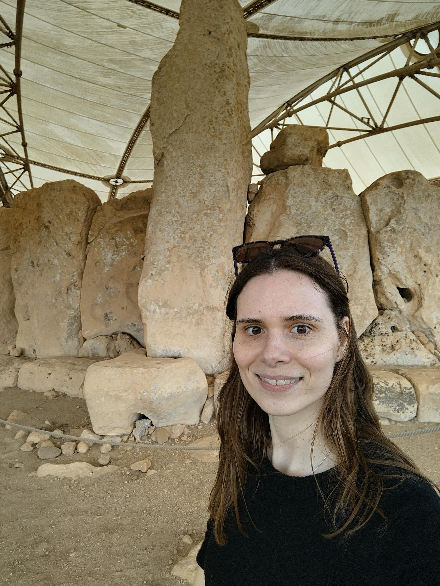
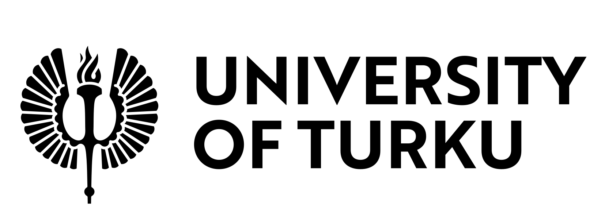

<h1>Tina Saupe, PhD</h1>

**|** Postdoctoral Researcher in Ancient Biomolecules

**|** Department of Biology  
**|** University of Turku, Finland

<a href="mailto:tina.saupe@utu.fi">
<i class="bi bi-envelope"></i> Email
</a>

<a href="https://scholar.google.com/citations?user=4ME-mJYAAAAJ&hl=en">
<i class="bi bi-mortarboard"></i> Scholar
</a>

<a href="https://orcid.org/0000-0003-1489-9646">
<i class="bi bi-person-badge"></i> ORCID
</a>

<a href="https://github.com/TinaSaupe">
<i class="bi bi-github"></i> GitHub
</a>

<a href="https://bsky.app/profile/tinasaupe.bsky.social">
<i class="bi bi-bluesky"></i> Bluesky
</a>

## About Me

Currently I am a Postdoctoral researcher in ancient Biomolecules in the <a href="https://sites.utu.fi/humandiversity/">Human Diversity consortium</a> at the <a href="https://www.utu.fi/fi/ihmiset/tina-saupe">University of Turku</a> 🇫🇮. 

I conducted my PhD studies at the <a href="https://genomics.ut.ee/en">Institute of Genomics, University of Tartu</a> 🇪🇪 and defended my dissertation titled [_**The genetic history of the Mediterranean before the common era: a focus on the Italian Peninsula**_](https://dspace.ut.ee/items/3a371275-20d4-4c16-bf11-84c9bd50a6ee) in August 2022. My research has mainly focused on the demographic history of the Mediterrean Basin during the Bronze Age period, however, I finally have decided to move on and will focus on Finnish population studies now. 

In addition, in 2023, I co-founded the open and international <a href="https://haam-community.github.io/">Human Ancient DNA, Ancestry and Mobility (HAAM-)community<a/> for early career researchers studying human population history, ancestry & mobility through ancient DNA. 

  
  

## What's New

**September 2025**  
🧬 Started as a Postdoctoral Researcher at the University of Turku.

**August 2025**  
💻 Launched my personal academic website.

**June 2025**  
🎤 Presented research at ...

## Research Interests

* Human Population Genetics * Anthropology * Ancient Biomolecules * Languages