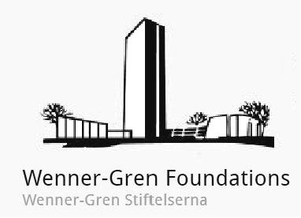

## Projects

List of selected projects. 

* Since February 2025: Study of Finnish population using ancient DNA
  * Workplace: University of Turku (Finland)
  * Position: Postdoctoral Researcher

* Since February 2023: BronzeAgeRake - Disentangling the human past in the Middle East during the Bronze Age using ancient DNA
  * Workplace: Uppsala University (Sweden)
  * Position: Lead
  
founded by:

  

* Since February 2022: ERC-funded project <a href="https://www.theancestorsproject.org/">Ancestors<a/> (funded 2020-2025)
  * Workplace: mainly University of Tartu (Estonia)
  * Position: Research Assistant
  

