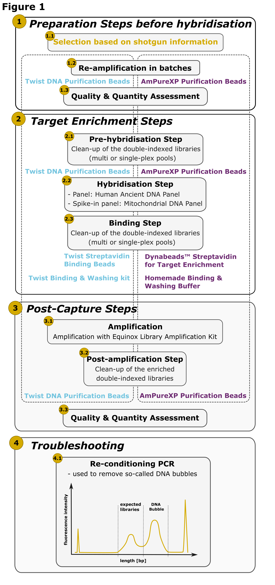
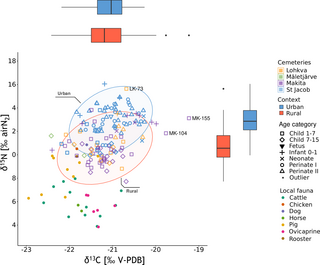
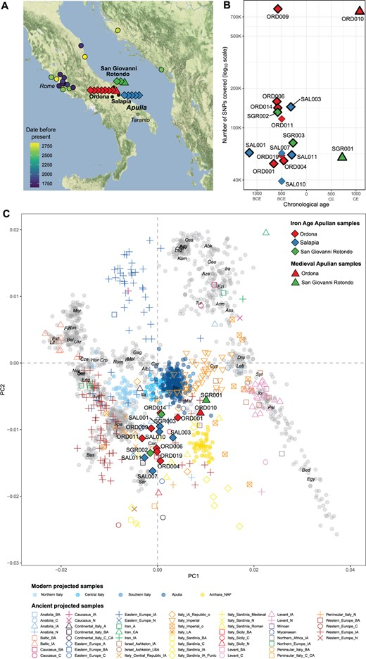
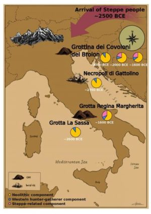

## Publications

This is a selection of my publications. For a complete list, please visit my
<a href="https://scholar.google.com/citations?user=4ME-mJYAAAAJ&hl=en" target="_blank">Google Scholar profile</a>.

::: {.publication}

::: {.publication-image}

{width=50% fig-alt="Let’s Tweap again: Economic and SNP retrieval optimisation for target enrichment of ancient DNA"}

:::

::: {.publication-content}

### Let’s Tweap again: Economic and SNP retrieval optimisation for target enrichment of ancient DNA

_BioRxiv_ · 2026 · ⭐ First author

**Authors**  
Tina Saupe *et al.*

**Keywords**
Ancient DNA
Target enrichment
Ancient Human Panel
Cost-optimisation

<a class="paper-button"
href="https://doi.org/10.64898/2026.01.15.699081"
target="_blank">
📄 Read paper
</a>

:::

:::

::: {.publication}

::: {.publication-image}

{width=100% fig-alt="Reconstructing infant feeding practices through stable isotope analysis: applying intrabone sampling to a medieval–early modern Estonian dataset"}

:::
::: {.publication-content}

### Reconstructing infant feeding practices through stable isotope analysis: applying intrabone sampling to a medieval–early modern Estonian dataset

_Journal of Archaeological Science: Reports_ · 2025 · 🤝 Co-author

**Authors**  
Alessandra Morrone *et al.*

**Keywords**
Infant feeding practices
Stable isotope analysis
Intraindividual sampling
Physiological stress

<a class="paper-button"
href="10.1016/j.jasrep.2025.105305"
target="_blank">
📄 Read paper
</a>

:::

:::

::: {.publication}

::: {.publication-image}

{width=100% fig-alt="Children of the grave: Investigating non-adult feeding practices in medieval and early modern Estonia through stable isotope analysis"}

:::
::: {.publication-content}

### Children of the grave: Investigating non-adult feeding practices in medieval and early modern Estonia through stable isotope analysis

_PLOS One_ · 2023 · 🤝 Co-author

**Authors**  
Alessandra Morrone *et al.*

**Keywords**
Estonia
Stable isotope analysis
non-adult study
breast-feeding

<a class="paper-button"
href="https://doi.org/10.1371/journal.pone.0279546"
target="_blank">
📄 Read paper
</a>

:::

:::

::: {.publication}

::: {.publication-image}

{width=60% fig-alt="The Genetic Origin of Daunians and the Pan-Mediterranean Southern Italian Iron Age Context"}

:::

::: {.publication-content}

### The Genetic Origin of Daunians and the Pan-Mediterranean Southern Italian Iron Age Context

_Molecular Biology and Evolution_ · 2022 · 🤝 Co-first author

**Authors**  
Serena Aneli, Tina Saupe *et al.*

**Keywords**
Ancient DNA
Daunians
Iron Age
Southern Italy

<a class="paper-button"
href="https://doi.org/10.1093/molbev/msac014"
target="_blank">
📄 Read paper
</a>

:::

:::

::: {.publication}

::: {.publication-image}

{width=70% fig-alt="Graphical abstract of Ancient genomes reveal structural shifts after the arrival of Steppe-related ancestry in the Italian Peninsula"}

:::

::: {.publication-content}

### Ancient genomes reveal structural shifts after the arrival of Steppe-related ancestry in the Italian Peninsula

_Current Biology_ · 2021 · 🤝 Co-first author

**Authors**  
Tina Saupe, Francesco Montinaro *et al.*

**Keywords**
Ancient DNA
Bronze Age
Italian Peninsula
Population history
Kinship

<a class="paper-button"
href="https://doi.org/10.1016/j.cub.2021.04.022"
target="_blank">
📄 Read paper
</a>

:::

:::